# Thymeleaf Companion for VS Code

**A Java-aware Thymeleaf development experience for Spring applications.**

Thymeleaf Companion brings your templates and Spring MVC code together. Get completion and validation from your Java model, navigate between controllers and views, and refactor fragments without leaving VS Code.

<p align="center">
  
</p>

## At a glance

- **Write templates faster** with Thymeleaf, HTML, model, route, fragment, and message-key completion.
- **Trust Java-backed expressions** with inferred model types, property and method completion, hover information, and diagnostics.
- **Move across your application** between Java handlers, views, fragments, routes, and model declarations.
- **Catch mistakes early** with diagnostics and quick fixes for expressions, attributes, variables, and model properties.
- **Refactor with confidence** using Java/Thymeleaf rename support and fragment extraction.

## See it in action

### Thymeleaf and Java-aware completion

Start with Thymeleaf attributes and utility objects, then complete properties and methods from the actual Java model. Collection element types and inherited methods are available too.

<table>
  <tr>
    <td align="center" width="50%">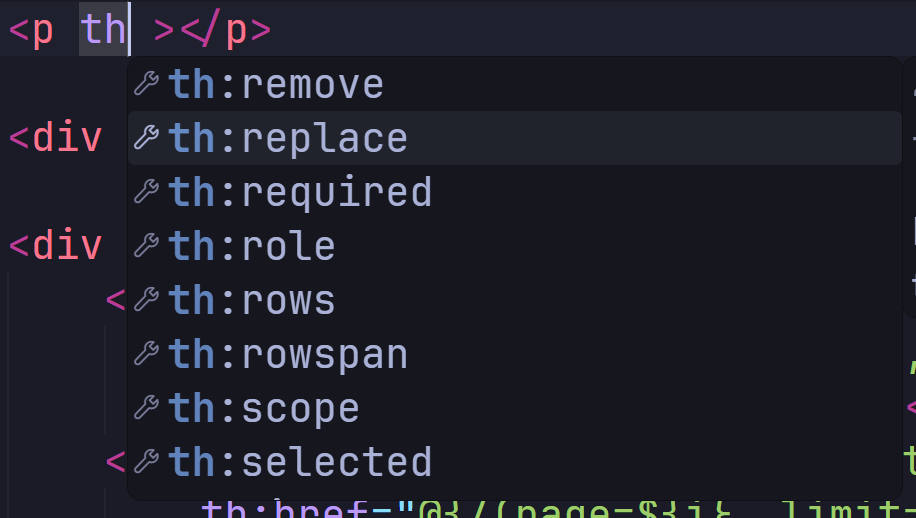<br><sub>Thymeleaf attributes</sub></td>
    <td align="center" width="50%">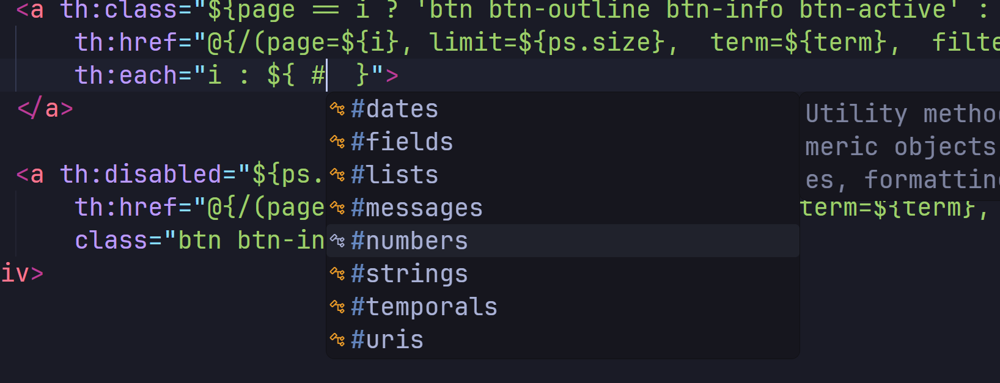<br><sub>Thymeleaf utility objects</sub></td>
  </tr>
  <tr>
    <td align="center">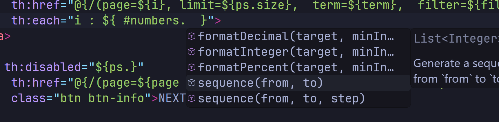<br><sub>Utility methods</sub></td>
    <td align="center">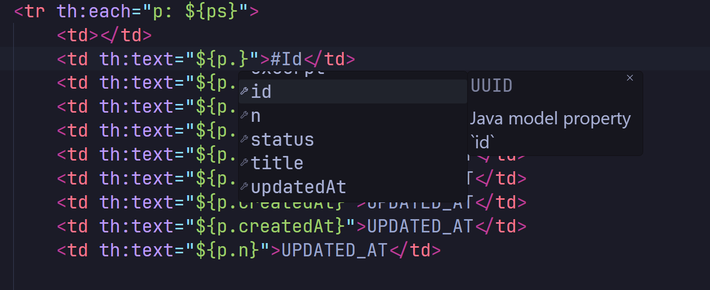<br><sub>Java model properties and hover</sub></td>
  </tr>
  <tr>
    <td align="center" colspan="2">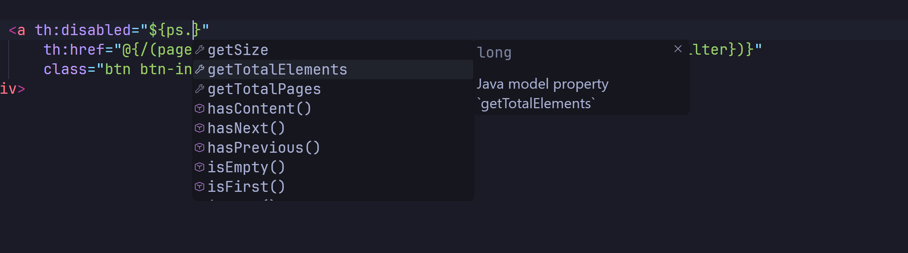<br><sub>Generic types and inherited pagination methods</sub></td>
  </tr>
</table>

### Templates, fragments, and routes

Complete template and fragment references in HTML, route paths in Thymeleaf URLs, and registered Spring routes after `redirect:` or `forward:` in Java view names.

<table>
  <tr>
    <td align="center" width="50%">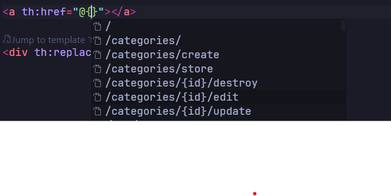<br><sub>Spring routes in a Thymeleaf URL</sub></td>
    <td align="center" width="50%">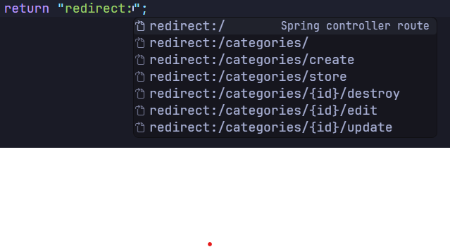<br><sub><code>redirect:</code> and <code>forward:</code> in Java</sub></td>
  </tr>
  <tr>
    <td align="center" colspan="2">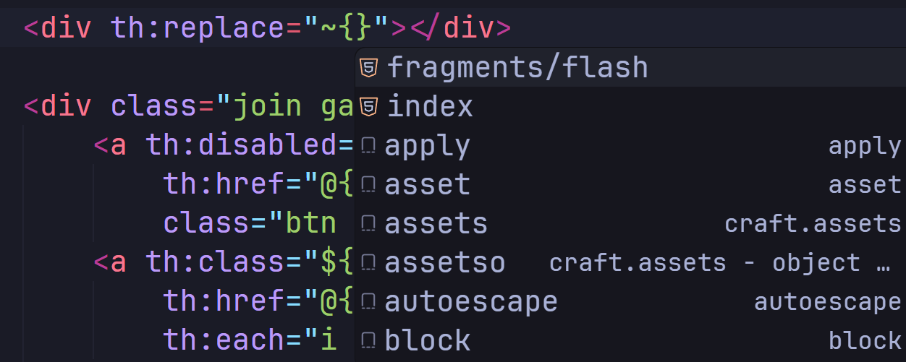<br><sub>Templates and fragments</sub></td>
  </tr>
</table>

### Navigate between Java and templates

Use CodeLens, gutter markers, or Go to Definition to follow a view reference to its template, a template to its handler, and a fragment use to its definition.

<table>
  <tr>
    <td align="center" width="50%">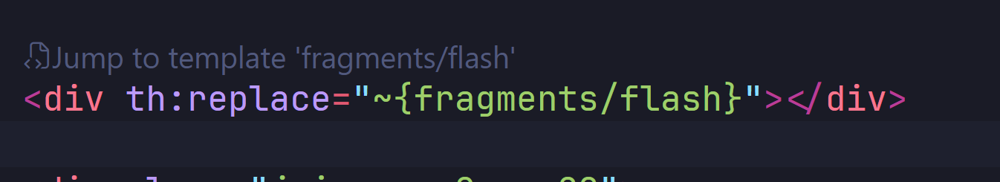<br><sub>Controller to template</sub></td>
    <td align="center" width="50%">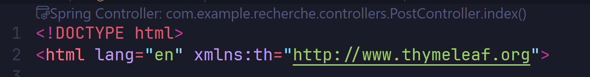<br><sub>Template to controller</sub></td>
  </tr>
  <tr>
    <td align="center" colspan="2">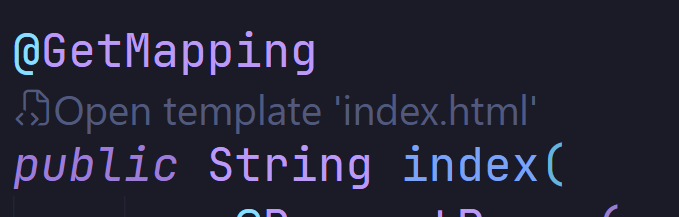<br><sub>Controller marker in a template</sub></td>
  </tr>
</table>

### Diagnostics and quick fixes

Find common mistakes as you edit and apply a suggested correction without interrupting your workflow.

<p align="center">
  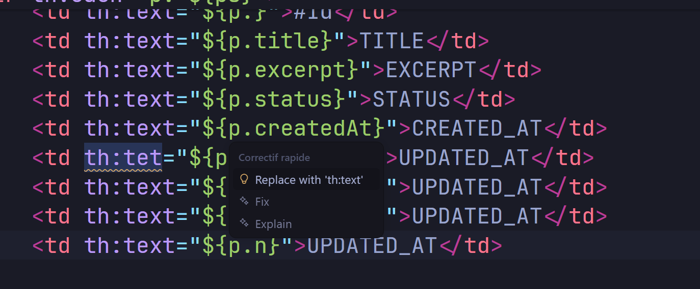
</p>

## Capabilities

### Completion that understands your application

- **HTML and Thymeleaf:** standard HTML global and element-specific attributes, Thymeleaf attributes, and their HTML5 `data-th-*` equivalents.
- **Expressions:** model variables, Java properties and no-argument methods, selection expressions, loop variables, fragment parameters, and Thymeleaf utility objects.
- **Java types:** fields, getters, record components, collection element properties, and methods inherited from indexed classes and interfaces.
- **Spring Beans:** complete bean references such as `@orderService` and their properties in SpEL expressions.
- **Templates and fragments:** template paths, fragment names, Layout Dialect references, and fragment parameters.
- **Spring routes:** registered controller paths in `@{...}` URLs and the official Spring MVC `redirect:` and `forward:` prefixes in Java controller view strings.
- **Messages:** message keys from Java `.properties` bundles.
- **Spring Security:** `sec:*` and `data-sec-*` attributes, including expression and attribute-value suggestions.
- **Editing details:** completion can start after whitespace when adding a `th:*` attribute, and partial attribute prefixes are replaced precisely.

### Java-backed model intelligence

The extension indexes Java Spring MVC controllers and makes their model available to the associated templates. It recognizes common `@Controller` and `@RestController` mappings, static view names, model attributes from `Model.addAttribute`, `ModelAndView.addObject`, `@ModelAttribute`, and Java fields, getters, and record components. Global model attributes from `@ControllerAdvice` are also available.

Model values initialized from service or repository calls can contribute their inferred Java type. This includes supported chained calls, common collection factories, literals, resolvable static factory methods, and local variables declared with `var`. When the Java language server can provide compiler-inferred types, `var` retains concrete generic types such as `Page<Category>` so expressions like `${categories.content}` and `${category.id}` can be analyzed against the actual model rather than an unresolved generic placeholder.

Java-backed model information powers completion, hover, navigation, semantic coloring, references, and diagnostics. Thymeleaf utility objects such as `#strings`, `#lists`, `#dates`, `#temporals`, `#messages`, and `#fields`, as well as implicit servlet objects such as `param`, are recognized. Local variables declared by `th:each` are available throughout their element, including earlier attributes on the same opening tag. Model attributes used inside nested URL expressions are also recognized, for example:

<p align="center">
  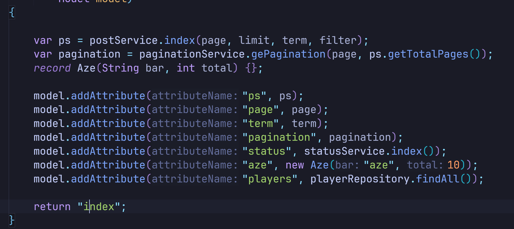
</p>

```html
<a th:href="@{/categories/{id}/edit(id=${category.id})}"
   th:text="${category.name}">
</a>
```

### Navigation and code understanding

- **Go to Definition (F12):** navigate from template expressions to Java model declarations, properties, methods, Spring routes, templates, and fragments.
- **Go to Type Definition:** inspect the resolved type of model variables and properties.
- **Java view navigation:** follow view names from `return "..."`, `ModelAndView`, or `setViewName(...)` to their template.
- **Fragment navigation:** move between fragment references and definitions, including `layout:fragment` definitions and their layout parent.
- **Local template variables:** navigate to declarations of `th:each`, `th:with`, and parameterized fragment variables.
- **`@thymesVar` declarations:** navigate to Java variables and types declared in Thymeleaf comments.
- **Controller and template links:** CodeLens and gutter markers connect Spring handlers, templates, and fragments. When a template has multiple candidate handlers, choose the intended controller.
- **References and rename:** find model-property and route references; rename supported Java model fields and record components together with matching Thymeleaf references.
- **Hover and highlighting:** inspect Java-backed properties and methods, and distinguish resolved Java members in Thymeleaf expressions.

### Diagnostics and quick fixes

Enabled by default, validation can report:

- Unclosed or malformed Thymeleaf expressions.
- Unknown Thymeleaf attributes, with suggestions for likely corrections.
- Undefined variables that are not supplied by the controller, a global model, a local template scope, a bean, or a built-in execution object.
- Unknown model properties when the Java type can be resolved.
- Missing templates, fragments, and Spring routes.

Quick fixes can insert missing expression braces, correct misspelled attributes, offer typo suggestions for undefined variables, and add a `@thymesVar` directive where appropriate.

### Refactoring and template editing

- **Extract Fragment:** select markup and extract it into the current template or a new template file. The refactoring preserves the selected root element where possible and creates destination directories as needed.
- **Create Template:** use the Thymeleaf command to create a template.
- **Local-variable highlighting:** selecting a declaration or use highlights matching `th:each`, `th:with`, and fragment-parameter references.
- **Syntax support:** Thymeleaf attributes, inline expressions, literal substitutions, Spring Security attributes, and Layout Dialect attributes receive syntax highlighting.
- **Snippets:** use the bundled Thymeleaf snippets in HTML files.

## Getting started

1. Install **Thymeleaf Companion** and the [Extension Pack for Java](https://marketplace.visualstudio.com/items?itemName=vscjava.vscode-java-pack).
2. Open a Spring Boot workspace in VS Code and let the Java language server import the project.
3. Open a template, typically under `src/main/resources/templates`.
4. Type a Thymeleaf attribute or expression, or use **Go to Definition** to follow a Java-backed reference.

Template paths are relative to the configured template locations and omit the `.html` extension. For example, `~{fragments/header :: navigation}` resolves to `fragments/header.html`.

## Requirements and Java integration

- Visual Studio Code **1.85.0** or later.
- A Java project using Spring MVC or Spring Boot.
- The [Extension Pack for Java](https://marketplace.visualstudio.com/items?itemName=vscjava.vscode-java-pack), which provides the `redhat.java` language server.

With the Java language server in Standard mode, the extension can use compiler and classpath-backed information to resolve JDK and dependency types, including inferred `var` types and inherited members. Source-based template and Java indexing remains available if that integration is unavailable; the fallback is reported in the **Thymeleaf Companion: Java** output channel.

Java source indexing is based on source analysis and is refreshed when files are saved. Complex generic bounds, dynamic mappings, overloaded method resolution, full Spring runtime behavior, and complete SpEL evaluation are outside the current analysis scope. Ambiguous model attributes are left unresolved rather than assigned an arbitrary type.

### Kotlin projects

Template-side features such as Thymeleaf and HTML completion, syntax highlighting, fragment navigation, and local-variable highlighting do not require Java sources and can still be used in Kotlin projects. The Spring and model index currently parses Java only, however, so Kotlin controllers, routes, model attributes, and model classes are not indexed. Java-backed features and controller CodeLens require indexable Java source.

## Settings

| Setting | Default | Description |
| --- | --- | --- |
| `thymeleaf.templateLocations` | `["src/main/resources/templates"]` | Template directories relative to each workspace folder. |
| `thymeleaf.validation.unclosedExpressions` | `true` | Report malformed or unclosed Thymeleaf expressions. |
| `thymeleaf.validation.unknownAttributes` | `true` | Report unknown Thymeleaf attributes and suggest close matches. |
| `thymeleaf.validation.unknownModelProperties` | `true` | Check properties when the model type can be resolved from Java sources. |
| `thymeleaf.validation.undefinedVariables` | `true` | Report variables that are not defined in the model or enclosing local scope. |

## Development

```sh
npm install
npm test
```

Press `F5` in VS Code to launch the Extension Development Host. `npm run compile` type-checks and bundles the extension; `npm run watch` rebuilds the bundles while editing.

## License and links

This project is licensed under the [MIT License](./LICENSE).

- [Source code](https://github.com/Houssam-OUATMANI/thymeleaf-vscode-extension)
- [Issues and feature requests](https://github.com/Houssam-OUATMANI/thymeleaf-vscode-extension/issues)
- [Changelog](./CHANGELOG.md)
